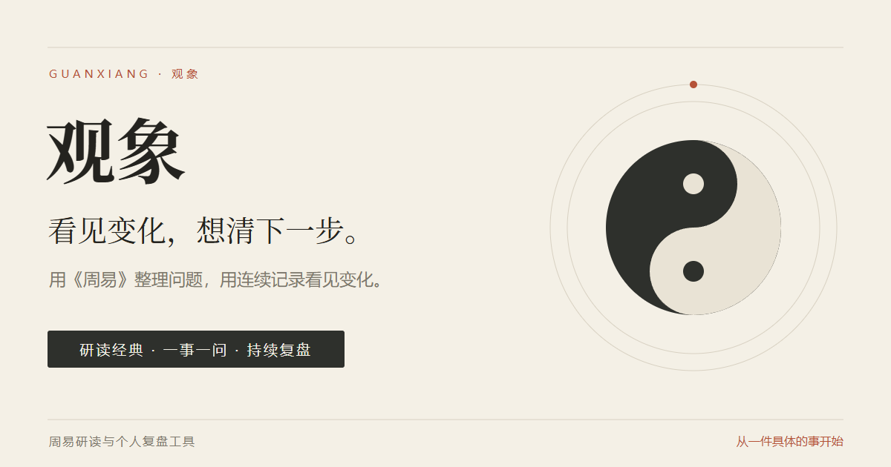

# 观象 · Guanxiang

**看见变化，想清下一步。**

观象是一款《周易》研读与个人复盘工具。你可以读经典、围绕一个具体问题起卦，记录自己的理解和行动，再在有新进展时回来复盘。

**[在线体验](https://guanxiang.wayella.com/) · [直接开始](https://guanxiang.wayella.com/#home) · [更新日志](CHANGELOG.md)**



## 可以做什么

- **读经典**：浏览六十四卦、卦辞与爻辞、十翼及易理专题，保存批注与研读进度；
- **问一件事**：先写清问题，再选择完整蓍草仪式或快速演蓍，逐步得到六爻与解读；
- **留下行动**：保存占问记录、札记、行动计划和后续进展，设置复盘日期；
- **对照变化**：手动关联同一事项，或主动使用 AI 查找关联、对照历次占问；
- **分享所选内容**：在本机生成卦象与研读卡片，私人问题和札记默认不公开；
- **跨设备使用**：游客先在本机体验，登录后同步占问记录；支持中文、英语和波斯语、手机布局与暗色阅读。

## 第一次使用

1. 在总览点击「开始占卜」，写下一个具体问题，例如「下周面试，我该怎样准备？」。
2. 选择节奏，确认问题后开始起卦，阅读本地解读；需要时再主动请求 AI 解读。
3. 写下一件准备采取的行动。过些天回来补充进展，看看自己的理解发生了什么变化。

也可以直接阅读经典。观象用于研读与自我反思，结果仅供参考，不提供确定预测，不替代现实判断。

## 本地运行

需要 **Node.js 22 或更新版本**（包含 npm）和现代浏览器。前端与本地服务器没有第三方 npm 依赖，克隆后即可启动：

```bash
git clone https://github.com/xiguajiushiwo/guanxiang-zhouyi.git
cd guanxiang-zhouyi
npm run dev
```

打开 **http://127.0.0.1:4175/**。经典阅读、起卦、本地解读、记录与导入导出可在本地使用；账号同步与 AI 需要另外配置服务端，见[部署说明](DEPLOYMENT.md)。本地启动不会自动连接生产账号或 AI 服务。

检查生产构建并启动：

```bash
npm run build:pages
npm start
```

`npm start` 会先重新构建，再从 `dist/` 提供网站。Windows 下可运行 `start-lan.bat`，在同一局域网用手机查看；设备 IP 的普通 HTTP 预览不包含要求 HTTPS 的全部浏览器能力。

## 检查与测试

```bash
npm run validate           # 经典内容、翻译、语法、算法与服务端单元检查
npm run test:browser       # 浏览器基本流程
npm run test:flow          # 手机与桌面的完整起卦流程
npm run test:navigation    # 刷新、返回、页面切换和异步加载
npm run test:brand         # 欢迎页、多语言和分享卡片
```

浏览器检查需要本机安装 Edge、Chrome 或 Chromium，可通过 `GUANXIANG_BROWSER_PATH` 指定可执行文件。测试会启动临时无头浏览器并清理配置目录；各套件共用本地端口 `4175`，请依次运行。更多命令见 [package.json](package.json)。

## 工程结构

| 文件 / 目录 | 用途 |
| --- | --- |
| `index.html`、`app.js`、各功能 CSS / MJS | 页面、导航、研读、起卦、分享与多语言 |
| `auth.html`、`auth.js`、`account-sync.mjs` | 登录入口与账号同步 |
| `hexagram-texts.json`、`ten-wings.json`、`principles*.json`、`relations.json` | 经文、专题与关联索引 |
| `worker/` | Cloudflare Workers AI 解读服务与限流 |
| `account-worker/` | D1 账号、会话与占问记录服务 |
| `functions/` | Cloudflare Pages 同源账号 / AI 代理 |
| `domain-worker/` | 当前正式域名入口 |
| `node-server.mjs`、`netlify/` | Node / Liara 服务与 Netlify AI 代理 |
| `test-*.mjs`、`run-browser-test.mjs` | 单元与浏览器回归检查 |
| `docs/` | 当前功能、品牌和资料维护说明 |
| `promo/`、`launch-kit.html` | 可编辑宣传图片与发布素材 |
| `build-pages.mjs` | 按白名单生成生产网站 `dist/` |

`dist/`、`output/`、依赖、日志及本机部署配置不提交到仓库。静态产物只包含网站必需文件，不包含测试、内部笔记或开发文档。

## 部署与数据

当前在线版本使用 **Cloudflare Pages + Workers + D1**。`guanxiang.wayella.com` 由域名 Worker 转发到 Pages；旧 [Pages 入口](https://guanxiang-zhouyi-evf.pages.dev/) 继续保留。

- 游客记录保存在当前浏览器，建议定期导出；清除浏览器数据或更换域名不会自动搬迁这些记录。
- 登录后，占问记录可同步到 D1；遇到已有本地记录时，界面提供合并选择。
- AI 仅在主动触发时调用，会发送这次功能所需的问题和记录资料。分享卡片默认不包含私人字段。
- 首次部署请配置自己的 Worker、D1、允许来源和 secrets。Netlify 当前只提供 AI 代理，账号服务需另行接入。

部署命令和各服务配置见 [DEPLOYMENT.md](DEPLOYMENT.md)、[AI Worker](worker/README.md) 和[账号 Worker](account-worker/README.md)。

## 进一步了解

- [经典资料与维护](docs/content.md)：来源、导入脚本与关联索引；
- [跟进与复盘](docs/journal-follow-up.md)：记录、行动、进展与数据合并；
- [同一事项的关联复盘](docs/case-review.md)：手动关联与 AI 对照；
- [手机导航](docs/mobile-navigation.md)：路由、状态保持与验证范围；
- [品牌与素材](docs/brand-guide.md)：视觉风格、分享规则与宣传素材。

目前仍在完善 iPhone Safari 真机验收、账号找回、首次体验、事项时间线和反馈入口。这些是后续方向，不代表已经上线。
